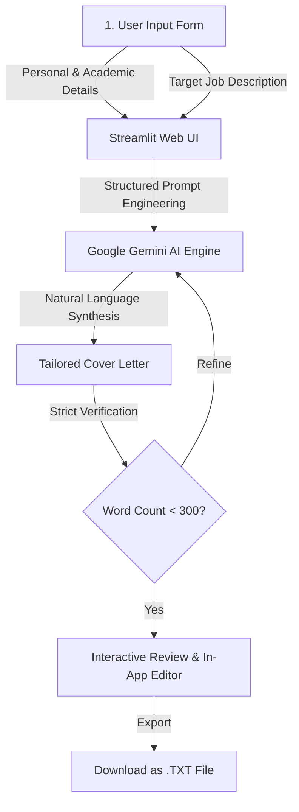

# 📝 CoverCraft AI – Smart Cover Letter Generator

> **Academic Submission Project: Task 2 – Topic 3 (AI Cover Letter Generator)**  
> **Course / Submission Code:** 2026BTAI079  
> **Student Name:** Tom Antony  
> **Target Deadline:** 20 November 2026  

---

## 🌟 Overview

**CoverCraft AI** is an intelligent, professional web application designed to help students, recent graduates, and job seekers instantly craft targeted, ATS-optimized cover letters tailored directly to specific job descriptions.

Powered by **Google Gemini AI** and built with **Python + Streamlit**, CoverCraft AI ensures that every generated cover letter strictly satisfies the under-300-words requirement while maintaining an executive, punchy, and persuasive tone.

---

## 🚀 Key Features

- **Personalized Alignment:** Bridges candidate education, core skills, and past projects directly to employer job requirements.
- **Strict Word Limit Compliance:** Guarantees concise cover letters strictly under 300 words (ideal range: 220–275 words).
- **Multiple Tone Profiles:** Choose between *Professional & Confident*, *Enthusiastic & High-Energy*, *Direct & Result-Oriented*, and *Technical & Analytical*.
- **Instant Demo Mode & Sample Profiles:** 1-click loading of realistic student and professional profiles for rapid testing and demonstrations.
- **One-Click .TXT Export:** Generates clean, ready-to-submit `.txt` files with custom filenames (`Cover_Letter_[Name]_[Company].txt`).
- **Interactive In-App Editor:** Review, refine, and tweak the generated letter in real time with an active word count tracker.
- **Secure API Key Handling:** Seamlessly accepts keys from `.env` or direct masked input in the Streamlit UI without storing secrets in version control.

---

## 🏗️ Architecture & Workflow



---

## 📂 Project Structure

```
CoverCraft-AI/
│
├── app.py                  # Main Streamlit web application
├── generator.py            # Gemini AI integration, prompt builder & word counter
├── sample_data.py          # Ready-to-use sample profiles for 1-click demo
├── requirements.txt        # Python package dependencies
├── .env.example            # Environment variable template
├── .gitignore              # Ignores sensitive keys (.env) and caches
└── README.md               # Complete project documentation
```

---

## ⚡ Quickstart Guide

### 1. Prerequisites
- Python 3.10+ installed
- A Google Gemini API Key ([Get a free key here](https://aistudio.google.com/apikey))

### 2. Clone / Setup the Repository
```bash
git clone https://github.com/your-username/CoverCraft-AI.git
cd CoverCraft-AI
```

### 3. Install Dependencies
```bash
pip install -r requirements.txt
```

### 4. (Optional) Configure API Key via `.env`
Create a `.env` file from the template:
```bash
cp .env.example .env
```
Open `.env` and paste your key:
```ini
GEMINI_API_KEY=AIzaSyYourActualKeyHere
```
*(Alternatively, you can enter the API key directly into the application's sidebar interface when running).*

### 5. Launch the Application
```bash
streamlit run app.py
```
The app will automatically open in your default web browser at `http://localhost:8501`.

---

## 🎓 College Submission Deliverables Guide

As per your course assignment sheet:

| Deliverable | Required Format | Suggested Filename |
|---|---|---|
| **Source Code** | ZIP file (or GitHub URL) | `2026BTAI079_Tom_Antony_Code.zip` |
| **Output Screenshot** | High-resolution image | `2026BTAI079_Tom_Antony_Output.jpg` |
| **Live App (Bonus)** | Streamlit Community Cloud URL | `https://your-app.streamlit.app` |

> ⚠️ **Important Security Reminder:**  
> Before creating the ZIP file or pushing to GitHub, verify that your `.env` file does **NOT** contain your live Gemini API key. Keep API keys private.

---

## 🌐 Deploying to Streamlit Community Cloud (Free)

1. Push your project to a GitHub repository:
   ```bash
   git init
   git add .
   git commit -m "feat: Initial commit of CoverCraft AI"
   git branch -M main
   git remote add origin https://github.com/<your-github-username>/CoverCraft-AI.git
   git push -u origin main
   ```
2. Go to [share.streamlit.io](https://share.streamlit.io/) and log in with your GitHub account.
3. Click **"New app"**.
4. Select your repository (`CoverCraft-AI`), branch (`main`), and main file path (`app.py`).
5. Under **Advanced settings > Secrets**, add:
   ```toml
   GEMINI_API_KEY = "AIzaSy..."
   ```
6. Click **Deploy!** Your app will be live with a shareable public URL.

---

## 📄 License
This project is created for educational and academic submission purposes under the MIT License.
